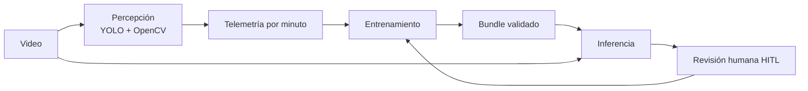

# VAAET — Video Advanced Analysis of Traffic

[](https://github.com/zgfnicolas/vaaet/actions/workflows/ci.yml)
[](vaaet-core/pyproject.toml)
[](LICENSE)

VAAET convierte videos de tránsito en telemetría por minuto, estados de
circulación y evidencia revisable por una persona. El caso de estudio es el
Puente General Manuel Belgrano.

> **Estado:** laboratorio ML con procesamiento batch en Google Colab. Los
> bundles sólo se promueven con evaluación humana y gates documentados. No es un
> sistema autónomo de seguridad ni de respuesta ante emergencias, y todavía no
> hay API ni Web App.

## Qué hace

- Detecta autos, camiones, colectivos, motocicletas y bicicletas, los sigue y
  estima su velocidad aproximada.
- Genera un video anotado y telemetría por minutos completos.
- Calcula 19 features y clasifica cada minuto como `Normal`, `Reduced` o
  `Congested` con un MLP.
- Señala posibles incidentes para revisión; `Accident` siempre requiere
  confirmación humana.
- Conserva datasets, holdouts y bundles reproducibles para reentrenar con
  Human-in-the-Loop (HITL).



**Stack:** Python 3.10–3.13 · YOLO 11 y OpenCV · TensorFlow/Keras y
scikit-learn · PostgreSQL 14+ opcional con Alembic · DVC · Google Colab.

## Inicio rápido

### Google Colab (recomendado)

Cada notebook instala los paquetes en el runtime; no hace falta instalar nada
localmente.

| Objetivo | Notebook | Requisito |
|---|---|---|
| Obtener telemetría y video anotado | [Recolección](https://colab.research.google.com/github/zgfnicolas/vaaet/blob/main/vaaet-ml/notebooks/data-collection/collect_traffic_telemetry.ipynb) | Video MP4; 60 s para la primera fila |
| Crear el modelo semilla o reentrenar con HITL | [Entrenamiento](https://colab.research.google.com/github/zgfnicolas/vaaet/blob/main/vaaet-ml/notebooks/training/train_traffic_state_classifier.ipynb) | Backup o CSV raw, o catálogo HITL |
| Analizar un video con un bundle | [Inferencia](https://colab.research.google.com/github/zgfnicolas/vaaet/blob/main/vaaet-ml/notebooks/inference/analyze_traffic_video.ipynb) | MP4 y bundle válido; 2 min para el primer estado |
| Comparar Champion y Challenger | [Evaluación](https://colab.research.google.com/github/zgfnicolas/vaaet/blob/main/vaaet-ml/notebooks/evaluation/evaluate_models_and_eda.ipynb) | Dos bundles y un holdout declarado |

PostgreSQL, Drive y la revisión HITL están desactivados hasta que la
configuración del notebook los habilite. Antes de configurar Secrets, GPU o
persistencia, leé la [guía de Colab](docs/operations/colab-guide.md).

### Instalación local

```bash
git clone https://github.com/zgfnicolas/vaaet.git
cd vaaet
python -m venv .venv
# PowerShell: .\.venv\Scripts\Activate.ps1   Bash/Zsh: source .venv/bin/activate
python -m pip install -e "./vaaet-core[vision,inference,dev]"
python -m pip install -e "./vaaet-persistence[admin,dev]"
python -m pip install -e "./vaaet-ml[training,evaluation,visualization,database,dev]"
python -m pip check
```

Los componentes se instalan en ese orden; [CONTRIBUTING.md](CONTRIBUTING.md)
explica qué extras usar en cada caso.

## Arquitectura

| Componente | Import | Responsabilidad |
|---|---|---|
| [`vaaet-core/`](vaaet-core/README.md) | `vaaet` | Percepción, telemetría, features, estados y carga segura del bundle; sin infraestructura |
| [`vaaet-persistence/`](vaaet-persistence/README.md) | `vaaet_persistence` | PostgreSQL compartido: consultas, escrituras, auditoría y migraciones |
| [`vaaet-ml/`](vaaet-ml/README.md) | `vaaet_ml` | Notebooks, datasets, entrenamiento, evaluación y DVC; nunca se usa para serving |
| [`vaaet-app/`](vaaet-app/README.md) | — | Reservado para una futura API y Web App |

El detalle está en la [arquitectura de software](docs/architecture/software-architecture.md).

## Documentación

| Tema | Referencia |
|---|---|
| Índice completo | [docs/index.md](docs/index.md) |
| Producto | [PRD](docs/product/product-requirements.md) · [reglas de negocio](docs/product/business-rules.md) · [roadmap](docs/roadmap.md) |
| Modelo y artefactos | [Model card](docs/ml/model-card.md) · [contrato del bundle](docs/ml/model-artifact-contract.md) · [guía DVC](docs/ml/dvc-guide.md) |
| Operación | [Guía de usuario](docs/operations/user-guide.md) · [Colab](docs/operations/colab-guide.md) · [PostgreSQL](docs/operations/postgresql-guide.md) |
| Cambios | [CHANGELOG](CHANGELOG.md) |
| Agentes de IA | [AGENTS.md](AGENTS.md) |

## Contribución y seguridad

Antes de proponer cambios, leé [CONTRIBUTING.md](CONTRIBUTING.md). Los problemas
de seguridad se reportan en privado según [SECURITY.md](SECURITY.md), nunca en
issues públicos; para dudas generales, consultá [SUPPORT.md](SUPPORT.md).

## Licencia

[AGPL-3.0-only](LICENSE). El extra `vaaet-core[vision]` incorpora Ultralytics
YOLO: una demo web pública debe cumplir el
[checklist AGPL](docs/governance/agpl-demo-release-checklist.md) y una
aplicación privada o comercial requiere una licencia Ultralytics Enterprise. Ver
el [registro de licencias de terceros](docs/governance/third-party-licenses.md).
