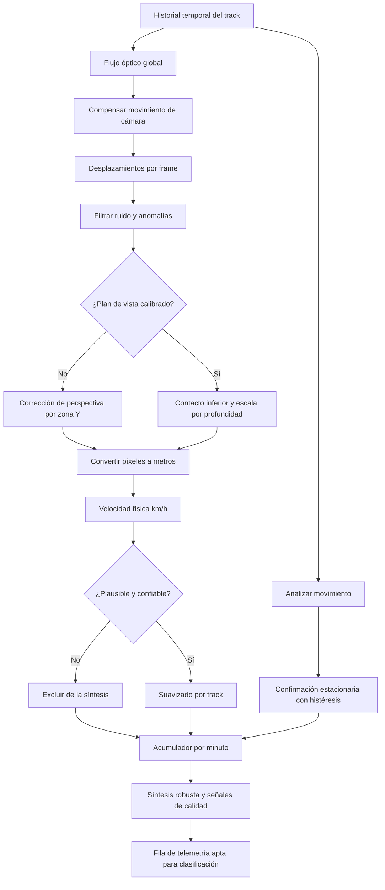

# Flujo de cálculo de velocidad physics-first

`vaaet-core/src/vaaet/vision/pipeline.py` coordina el análisis ordenado; la
estimación vive en `vaaet-core/src/vaaet/vision/speed.py`. El resultado depende
del historial de cada track y no ofrece un fallback de velocidad inventada.

La fusión MLP de velocidad es un path dormido y no integra el runtime activo.
Con un `VideoViewPlan`, un cambio de vista reinicia estado temporal y cualquier
minuto mixto se descarta antes de esta síntesis. La escala por profundidad no es
una homografía ni habilita afirmaciones de precisión física sin ground truth.
