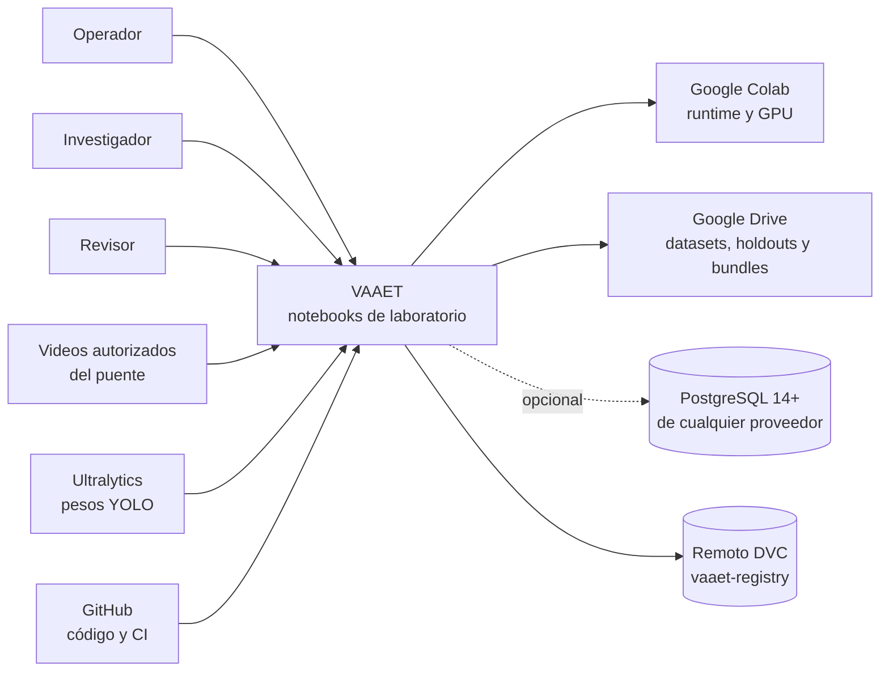
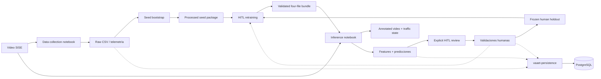

# Arquitectura de software — VAAET

Describe cómo está construido VAAET hoy y por qué. Las decisiones que llevaron
hasta acá están en el [registro de ADRs](decisions/README.md); los requisitos,
en el [PRD](../product/product-requirements.md).

## 1. Objetivos de calidad

En orden de prioridad:

1. **Integridad y trazabilidad.** Cada dato, predicción y decisión humana se
   puede rastrear hasta su video, bundle y corrida, sin sobrescribir historia
   ([RN-09](../product/business-rules.md#rn-09--una-revisión-identifica-un-bundle-exacto),
   [RN-14](../product/business-rules.md#rn-14--validaciones-append-only-con-una-única-etiqueta-efectiva)).
2. **Seguridad operacional conservadora.** Ante la duda, el sistema no publica:
   `Accident` es humano, los bundles se validan antes de cargarse y los minutos
   incompletos se descartan
   ([RN-02](../product/business-rules.md#rn-02--accident-es-exclusivamente-humano),
   [RN-08](../product/business-rules.md#rn-08--manifiesto-antes-que-binarios)).
3. **Portabilidad y reproducibilidad.** El core no depende de infraestructura,
   PostgreSQL es neutral respecto del proveedor y cada entrenamiento queda fijado
   por un input lock.

## 2. Restricciones

- Python 3.10–3.13 en todos los componentes.
- Google Colab es el runtime: la GPU, el tipo de acelerador, las cuotas y la
  duración de sesión no están garantizados.
- Licencia AGPL-3.0-only; servir YOLO exige la vía de
  [ADR-0022](decisions/0022-agpl-public-demo-path.md).
- Videos, datasets privados, calibraciones reales y binarios ML no se versionan
  con Git.
- `vaaet-app/` está reservado: no hay API, frontend ni workers.

## 3. Contexto (C4 nivel 1)

Los roles de cada persona están en [roles y permisos](../product/roles.md).

## 4. Estrategia de solución

- **Monorepo de tres distribuciones** con dependencias en un solo sentido:
  `vaaet-ml` → `vaaet-persistence` → `vaaet-core`
  ([ADR-0021](decisions/0021-portable-core-and-ml-laboratory-boundary.md),
  [ADR-0028](decisions/0028-shared-postgresql-persistence-layer.md)).
- **Visión Pipe-and-Filter síncrona y ordenada**, sin colas ni workers.
- **Bundle manifest-first**: el manifiesto y sus checksums se validan antes de
  deserializar binarios.
- **HITL append-only**: las decisiones humanas se agregan y nunca se editan.
- **PostgreSQL opcional y schema-as-code**: Alembic es la única autoridad DDL
  ([ADR-0024](decisions/0024-provider-neutral-postgresql-and-schema-as-code.md)).

## 5. Contenedores (C4 nivel 2)

| Contenedor | Ruta | Responsabilidad |
|---|---|---|
| Notebooks | `vaaet-ml/notebooks/` | UI Colab, selección de entradas y descargas; sólo orquestan |
| Core operativo | `vaaet-core/src/vaaet/` | Visión, telemetría, 19 features, estados, contratos e inferencia manifest-first |
| Persistencia | `vaaet-persistence/src/vaaet_persistence/` | Perfiles, engines, consultas, escrituras, auditoría y Alembic |
| Laboratorio ML | `vaaet-ml/src/vaaet_ml/` | Datos (`data/`), entrenamiento (`training/`), evaluación (`evaluation/`) y sintéticos (`features/`) |
| Base de datos | PostgreSQL 14+ | Raw, features, predicciones, feedback y corridas; ver [modelo de datos](data-model.md) |
| Almacenamiento | Google Drive y remoto DVC | Snapshots, sesiones HITL, input locks, holdouts y bundles |

El recorrido detallado de cada dato está en el
[linaje de datos](data-lineage.md) y los diagramas complementarios, en el
[índice de diagramas](diagrams/index.md).

### Core: visión e inferencia

`vaaet.vision.analysis.analyze_video()` es el límite común entre adquisición e
inferencia. `TrafficStateEngine` encapsula la clasificación por minuto sobre un
bundle ya validado; no implementa I/O remoto, colas ni persistencia. Sin
proveedor de predicción muestra “Telemetry Collection”; con proveedor incorpora
estado y confianza. El módulo no importa TensorFlow.

Internamente, visión ejecuta filtros síncronos y ordenados:
`FramePacket → PerceptionPacket → TrackingPacket → MotionPacket → RenderedFramePacket`.
Una sesión por clip conserva el estado de flujo óptico, SORT, velocidad,
estacionario y telemetría; no hay colas ni workers entre filtros. Una cola local
acotada entre lectura y YOLO sólo será candidata tras comparar estas métricas
base con el mismo clip, GPU, modelo y resolución, sin alterar el orden ni la
telemetría.

### Laboratorio: entrenamiento

El notebook de entrenamiento expone dos entradas explícitas que convergen antes
del split: `SEED_BOOTSTRAP` calcula features desde raw y produce un piloto;
`HITL_RETRAINING` consume el snapshot semilla vigente y todos los paquetes activos
del catálogo HITL sin recalcular features. Antes del bundle registra la selección
exacta en un input lock. El mismo `input_policy` del manifiesto se usa en serving.

### Frontera con la aplicación futura

La futura Web App vivirá en `vaaet-app/`, consumirá únicamente una API
versionada y nunca accederá directamente a bundles, DVC, Drive, PostgreSQL ni
módulos Python. Los workers de API usarán `vaaet-core` y `vaaet-persistence`;
el adaptador API será dueño de trabajos asíncronos, storage, contratos HTTP e
identidad de servicio.

## 6. Conceptos transversales

### Identidad y continuidad

`continuity_id` separa tramos físicos continuos: cambia ante un clip nuevo, una
transición de vista o un hueco mayor a 90 segundos. `model_revision` identifica
un bundle exacto y no reemplaza a la etiqueta semántica `model_version`
([ADR-0026](decisions/0026-temporal-continuity-and-immutable-model-revisions.md)).

### Tiempo

`record_time` es siempre timezone-aware en UTC, en memoria, CSV, backups y
PostgreSQL. La hora argentina se usa sólo para features circadianas y
presentación.

### Vistas y calibración local

Un `VideoViewPlan` opcional permite que un video offline declare tramos estables
de cámara o zoom mediante rangos de frames y perfiles `CameraCalibration`
versionados. Cada perfil usa referencias métricas conocidas a distintas
profundidades y el core interpola la escala sobre el contacto inferior de cada
vehículo. El plan no se lee desde el core: notebooks y futuros adaptadores lo
cargan localmente y fuera de Git/DVC.

Una transición reinicia flujo óptico, SORT, velocidad, estacionario y contexto
de clasificación. No hay reidentificación entre vistas. Un minuto que cruza una
transición se descarta en lugar de mezclar conteos o geometrías; los reportes de
segmento quedan en `VideoAnalysisResult.view_segments` sin alterar telemetría
v3 ni las 19 features. La guía operativa está en
[calibración multi-vista](../operations/multi-view-calibration-guide.md).

### Integraciones

- **PostgreSQL** es opcional y portable entre proveedores. `vaaet-persistence`
  centraliza su contrato para notebooks y futuros backends; cuatro perfiles
  aplican mínimo privilegio y cada proceso aporta su identidad.
- **Google Drive** transporta el bundle y conserva semilla, sesiones HITL, input
  locks y holdouts humanos entre sesiones Colab.
- **DVC** versiona el directorio `vaaet-ml/artifacts/traffic-state` como una
  unidad; Git identifica cada versión por commit o tag y cada entorno configura
  su remoto lógico `vaaet-registry` sin versionar proveedor ni credenciales.
- **Pesos YOLO**: se descargan en runtime y no pertenecen al repositorio.

### Escrituras, idempotencia y errores

Cada escritura PostgreSQL registra un comprobante en la misma transacción que
los datos; una reconciliación verifica el contenido y nunca reinserta. Los
errores públicos se traducen a errores de dominio y no incluyen mensajes del
driver, parámetros ni secretos.

### Métricas del pipeline

`VideoAnalysisResult.metrics` expone `PipelineMetrics` inmutable: frames
procesados, tiempo total, FPS end-to-end y acumulados por etapa con reloj
monotónico. El core no mide RAM ni VRAM; cualquier benchmark de Colab debe
registrarlas fuera del contrato portable.

### Validación

GitHub Actions cubre Python 3.10–3.13 y las tres distribuciones,
`pip check`, smoke imports, Ruff, pytest, compilación de los cuatro notebooks,
enlaces, DVC y ausencia de binarios ML en Git. GPU, Drive, videos reales y
PostgreSQL se validan manualmente en Colab. El detalle está en el
[plan de pruebas](../quality/test-plan.md).

## 7. Riesgos y deuda técnica

| Riesgo | Mitigación vigente |
|---|---|
| Colab se desconecta durante un video largo | Procesar clips acotados y conservar outputs materializados; no hay checkpoint frame a frame. |
| Colab no asigna GPU | Preflight antes de la tarea costosa; el workflow de visión se detiene en lugar de usar la CPU. |
| La cámara cambia de zoom o ángulo dentro de un clip | `VideoViewPlan` explícito y descarte de minutos mixtos; no se publica MAE sin ground truth. |
| Poco soporte real de `Congested` y ningún accidente confirmado | `Accident` fuera del MLP; sintéticos sólo en train; gates mínimos de episodios y exposición. |
| Etiquetado automático circular | La memoria proxy decrece hasta cero a medida que crece el soporte humano por clase. |
| Contaminación o deriva del holdout humano | Snapshots inmutables, clips excluidos de train y fingerprint. |
| Drift de los patrones de tránsito | Sin monitoreo en producción todavía; la evaluación Champion--Challenger detecta drift entre cohortes. |
| Incompatibilidad de dependencias (TensorFlow, YOLO) | Extras declarados, CI en Python 3.10–3.13 y `pip check`. |
| Exposición de credenciales PostgreSQL | Secrets por perfil, `.env` ignorado y errores redactados; ante exposición, rotar y auditar. |

Deuda técnica conocida:

- `vaaet_ml.traffic_predictions` referencia `telemetry_features` con
  `ON DELETE CASCADE`. Ningún rol de workflow tiene `DELETE`, pero un borrado
  administrativo de una feature eliminaría sus predicciones no revisadas.
  Cambiarlo requiere una revisión Alembic nueva; ver
  [políticas referenciales](data-model.md#políticas-referenciales).
- Las vistas `public.*` de compatibilidad se mantienen durante 4.x y se
  eliminarán en 5.0.0.
- El bloqueo del catálogo HITL es local al host: no coordina runtimes de Colab
  independientes.
